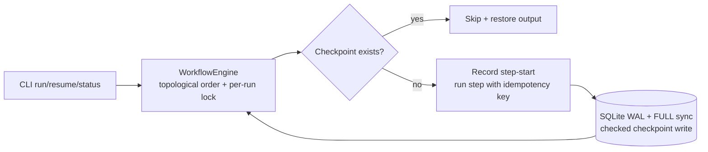

# Stateful Long-Running Agent


**Checkpointed workflows that survive crashes — resume a 24h task cleanly after `kill -9`.**

**Target:** 24h task resumes cleanly after kill -9.
**Shows:** You build durable systems not fragile demos.

## Problem → Solution
Long agent jobs die the way all long jobs die: deploy, OOM, laptop sleep, `kill -9` — and a naive agent restarts from zero, re-paying and re-doing hours of work (or worse, double-charging a side effect). This engine checkpoints to SQLite around *every* step, records each step's start *before* it runs, and resumes exactly where it stopped. No Temporal server needed — the durable-execution pattern, implemented locally, with the Temporal mapping documented.

## The guarantee, stated precisely
**At-least-once execution with idempotent replay.** A step whose checkpoint
committed is never re-executed. A step in flight when the process died runs
again on resume — with the *same* idempotency key, derived from the
canonicalised context values and passed into the step via
`ctx["_idempotency_key"]`. A step that honours its key (the demo steps do)
applies its side effect exactly once; a step that ignores the key may apply
its effect more than once. Earlier versions of this README implied
"effectively-once" effects — that claim was removed in 0.1.1 because the
engine alone cannot provide it; the key mechanism can, per step.

## Architecture

Full detail + Temporal mapping table: [docs/ARCHITECTURE.md](docs/ARCHITECTURE.md)

## Quickstart (<2 min, offline)
```bash
git clone https://github.com/lionelsimai/stateful-long-running-agent && cd stateful-long-running-agent
pip install -e .
stateful-agent --db demo.db run --run-id demo1
stateful-agent --db demo.db status demo1
stateful-agent --db demo.db resume demo1   # no-op: everything already checkpointed
python examples/crash_test.py              # the real kill -9 test
python -m pytest -q
```

## Real demo output
```text
$ stateful-agent --db demo.db run --run-id demo1
run=demo1 status=completed executed=ingest,clean,chunk,embed,summarise,publish skipped=-

$ python examples/crash_test.py
worker killed with SIGKILL (returncode=-9)
checkpoints survived kill -9: ['ingest', 'clean']
resume: status=completed executed=['chunk', 'embed', 'summarise', 'publish'] skipped=['ingest', 'clean']
side effects: ['ingest', 'clean', 'chunk', 'embed', 'summarise', 'publish'] (total=6)
CRASH TEST PASS
```

## Benchmarks
The crash test is deterministic, not timed: the worker blocks *after* its
2nd checkpoint commits and writes a ready flag, the parent SIGKILLs it, and
the test fails loudly unless resume skips exactly those 2 steps and the
append-only side-effect log ends with each of the 6 steps exactly once.
It runs in the pytest suite as a real subprocess test and passes 5/5
consecutive runs.
```bash
python benchmarks/benchmark.py   # wraps the kill -9 crash test
# target: task resumes cleanly after kill -9 -> PASS
```
Simulated steps stand in for a 24h task's hours-long steps — the checkpoint/resume mechanics are identical at any step duration, because durability lives in the store, not the step.

## Honest limitations
- At-least-once, not exactly-once: replayed steps must honour their idempotency key to avoid duplicate external effects (see the guarantee above).
- Single-process, single-writer SQLite — right for one host, not a distributed fleet (that's the step where the documented Temporal mapping takes over). A per-run lock stops two live processes running the same run; a dead owner's lock is reclaimed.
- No built-in retries/backoff policy yet (on the roadmap).

## Roadmap
- [ ] Retry policies with exponential backoff per step
- [ ] Human-approval step type (pause until approved, durable across restarts)
- [ ] Temporal worker adapter with the same workflow definitions
- [ ] Checkpoint encryption at rest

## Contributing
See [CONTRIBUTING.md](CONTRIBUTING.md). MIT — [LICENSE](LICENSE). By Lionel Sim, The AI Capitol.
