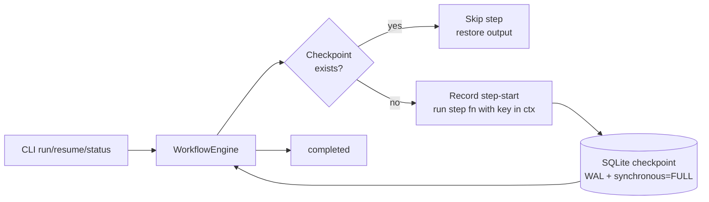

# Architecture

## Execution model
- Steps form a DAG; the engine executes them in **topological order**
  computed from `depends_on` (list order is irrelevant). Cycles and
  missing dependencies are rejected at validation.
- For each step the engine (1) derives an idempotency key from the
  canonicalised context *values*, (2) records a **step-start** row,
  (3) calls the step with `ctx["_idempotency_key"]` set, (4) saves the
  result as a checkpoint with a *checked* write — a conflicting
  checkpoint raises `CheckpointConflictError` instead of being
  silently ignored.
- A per-run lock (owner pid in the DB) prevents two live processes
  from executing the same run; a dead owner's lock is reclaimed, and a
  stale `running` status left behind by a killed process is reconciled
  to `interrupted` on the next run.

## How this maps to Temporal
| This project | Temporal |
|---|---|
| Workflow + Step DAG | Workflow + Activities |
| SQLite checkpoint after each step | Event history / durable execution |
| Idempotency key (run+step+context-values hash) | Activity idempotency / dedupe |
| `resume` re-entering `run()` | Worker replay after crash |
| Run status in SQLite | Workflow visibility |

No Temporal server is required here: the pattern is implemented locally
with SQLite (WAL mode + `synchronous=FULL`, so a `kill -9` cannot corrupt
or lose committed checkpoints).
For production scale, swap `CheckpointStore` for Temporal's history service
and keep the same step/idempotency discipline.

## Guarantees
- **At-least-once execution with idempotent replay.** A step is never
  re-executed once its checkpoint is committed.
- A step interrupted mid-flight is re-run with the *same* idempotency
  key, which is passed into the step so it can suppress duplicate
  side effects (the demo workflow's effect log proves exactly-once
  effects *for key-honouring steps* in the crash test).
- The engine does **not** claim effectively-once effects for arbitrary
  steps: a step that ignores its key may apply its effect more than
  once after a crash. That is the honest contract, and it matches how
  Temporal activities behave without idempotent receivers.
