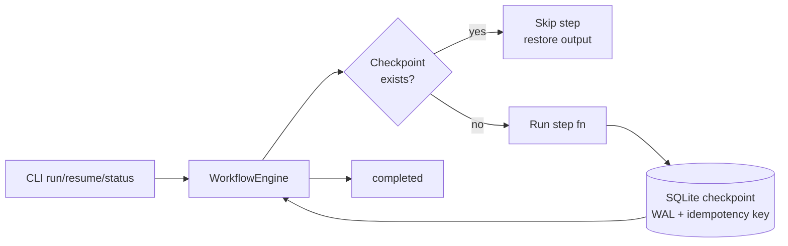

# Architecture

## How this maps to Temporal
| This project | Temporal |
|---|---|
| Workflow + Step DAG | Workflow + Activities |
| SQLite checkpoint after each step | Event history / durable execution |
| Idempotency key (run+step+payload hash) | Activity idempotency / dedupe |
| `resume` re-entering `run()` | Worker replay after crash |
| Run status in SQLite | Workflow visibility |

No Temporal server is required here: the pattern is implemented locally with
SQLite (WAL mode, so a `kill -9` cannot corrupt committed checkpoints).
For production scale, swap `CheckpointStore` for Temporal's history service
and keep the same step/idempotency discipline.

## Guarantees
- At-least-once scheduling, effectively-once effects via idempotency keys.
- A step is never re-executed once its checkpoint is committed.
